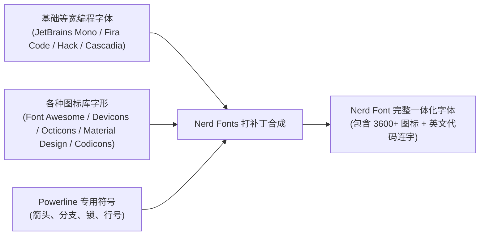

# Nerd Fonts 详解与全平台（Linux / macOS / Windows / WSL）安装配置指南

在当今的现代开发环境中，终端美化工具（如 **Starship**、**Powerlevel10k**、**Oh-My-Zsh**）、现代命令行工具（如 **eza**、**yazi**、**bat**、**lazygit**）以及现代编辑器（如 **Neovim**、**VS Code**、**Helix**）广泛依赖各种开发图标。

而这一切的基石就是 **Nerd Fonts**。本文将全面介绍什么是 Nerd Fonts、它的命名规范与工作原理，并提供 Linux、macOS、Windows 及 WSL 的详细安装与配置指南。

---

## 一、 什么是 Nerd Fonts？

[Nerd Fonts](https://www.nerdfonts.com/) 是一个开源项目，它的核心目标是：**收集海量开发相关的矢量图标，并将它们注入（Patch）到最受程序员欢迎的高质量等宽编程字体中**。



### 1. 它包含了哪些图标？
Nerd Fonts 聚合了 3,600+ 个常用图标，覆盖：
* **Powerline Symbols**：Git 分支（``）、状态栏箭头（``、``、``、``）
* **Devicons & Seti-UI**：编程语言与开发工具图标（Rust、Docker、Python、Go、K8s、Git 等）
* **Font Awesome & Font Linux**：系统架构、服务器、硬件图标
* **Material Design & Codicons**：VS Code 风格图标、UI 操作指示符
* **Octicons**：GitHub 官方图标集

### 2. 字体命名的后缀规则（必看）
以 `JetBrains Mono` 为例，下载或配置时经常看到多种变体：

| 命名变体 | 含义与适用场景 |
| :--- | :--- |
| **`JetBrainsMono Nerd Font`** | **标准版**。图标宽度自适应（部分宽图标占 2 个字符宽度，更自然）。适合支持变宽图标的现代终端。 |
| **`JetBrainsMono Nerd Font Mono`** | **严格等宽版**。每个图标被强行缩放到正好占用 1 个字符宽度。适合对字符栅格对齐极其严苛的终端，防止遮挡文字。 |
| **`JetBrainsMono Nerd Font Propo`** | **比例字体版**（Proportional）。字符非等宽，适合用于系统 UI、GUI 菜单等，**不建议用于终端**。 |
| **`Symbols Nerd Font (Mono)`** | **纯图标补丁版**。内部**没有英文字母和数字**，仅包含图标。适合配合 Kitty `symbol_map` 或 Fontconfig 作为辅助补充字体。 |

---

## 二、 全平台安装指南

---

### 1. Linux（Ubuntu / Debian / Arch / Fedora 等）

#### 方式 A：手动安装（全发行版通用，推荐）

以最常用的 **`JetBrainsMono Nerd Font`** 和 **`Symbols Nerd Font`** 为例：

```bash
# 1. 创建用户字体目录
mkdir -p ~/.local/share/fonts

# 2. 下载并解压 JetBrainsMono Nerd Font（一体化代码字体）
curl -fLo ~/.local/share/fonts/JetBrainsMono.tar.xz \
  https://github.com/ryanoasis/nerd-fonts/releases/latest/download/JetBrainsMono.tar.xz
tar -xf ~/.local/share/fonts/JetBrainsMono.tar.xz -C ~/.local/share/fonts/
rm ~/.local/share/fonts/JetBrainsMono.tar.xz

# 3. （可选）下载 Symbols 纯图标字体（适合 Kitty symbol_map）
curl -fLo ~/.local/share/fonts/NerdFontsSymbolsOnly.zip \
  https://github.com/ryanoasis/nerd-fonts/releases/latest/download/NerdFontsSymbolsOnly.zip
unzip -o ~/.local/share/fonts/NerdFontsSymbolsOnly.zip -d ~/.local/share/fonts/
rm ~/.local/share/fonts/NerdFontsSymbolsOnly.zip

# 4. 刷新系统字体缓存
fc-cache -fv
```

#### 方式 B：包管理器安装

* **Arch Linux (AUR)**：
  ```bash
  # 安装 JetBrains Mono Nerd Font
  yay -S ttf-jetbrains-mono-nerd
  # 或安装纯符号包
  yay -S ttf-nerd-fonts-symbols
  ```
* **Fedora (COPR)**：
  ```bash
  sudo dnf copr enable che/nerd-fonts
  sudo dnf install nerd-fonts-jetbrains-mono
  ```

---

### 2. macOS

macOS 推荐使用 **Homebrew** 进行一键安装，省去手动下载解压的繁琐流程。

```bash
# 安装 JetBrainsMono Nerd Font（完整代码字体）
brew install --cask font-jetbrains-mono-nerd-font

# 或安装 FiraCode / Hack / Meslo 等常用字体
brew install --cask font-fira-code-nerd-font
brew install --cask font-meslo-lg-nerd-font
brew install --cask font-symbols-only-nerd-font
```

> **手动安装方式**：从官网或 GitHub Releases 下载 `.zip`，解压后双击字体文件，在弹出的“字体册（Font Book）”中点击**安装**即可。

---

### 3. Windows

#### 方式 A：使用包管理器（推荐）

* **使用 Winget（Windows 10/11 内置）**：
  ```powershell
  winget install --id DEV-GAPS.JetBrainsMonoNerdFont
  # 或 Cascadia Code (微软官方字体修改版)
  winget install --id DEV-GAPS.CaskaydiaCoveNerdFont
  ```

* **使用 Scoop**：
  ```powershell
  scoop bucket add nerd-fonts
  scoop install JetBrainsMono-NF
  ```

#### 方式 B：手动安装
1. 前往 [Nerd Fonts Downloads](https://www.nerdfonts.com/font-downloads) 下载对应字体的压缩包（如 `JetBrainsMono.zip`）。
2. 解压压缩包。
3. 全选解压出来的 `.ttf` 文件，鼠标右键选择 **“为所有用户安装”**（或“安装”）。

---

### 4. WSL (Windows Subsystem for Linux) 专有注意事项

> [!IMPORTANT]
> **WSL 中的终端图标由 Windows 端的宿主渲染！**
> 
> 如果你在 WSL2 中使用 zsh、Starship 等工具，**字体必须安装在 Windows 系统上**，并在 Windows 端的终端模拟器（如 **Windows Terminal**）中进行设置，而不是仅仅在 WSL Linux 子系统内装字体。

#### WSL + Windows Terminal 正确配置步骤：
1. 按照上文 **Windows 安装步骤**，将 `JetBrainsMono Nerd Font` 安装在 **Windows 系统**中。
2. 打开 Windows Terminal -> 点击下拉箭头 -> 打开 **“设置”**（快捷键 `Ctrl + ,`）。
3. 在左侧选择 **“Ubuntu (或你的 WSL 分发版)”** -> 点击 **“外观”**。
4. 将 **字体（Font face）** 设置为：`JetBrainsMono Nerd Font` 或 `CaskaydiaCove Nerd Font`。
5. 保存即可，WSL 终端内的所有图标将瞬间正常渲染。

---

## 三、 终端与编辑器配置示例

### 1. Kitty 终端 (`~/.config/kitty/kitty.conf`)

* **方案 A（直接使用打好补丁的字体）**：
  ```conf
  font_family      JetBrainsMono Nerd Font
  bold_font        auto
  italic_font      auto
  bold_italic_font auto
  ```
* **方案 B（主字体 + 独立符号映射）**：
  ```conf
  font_family      JetBrains Maple Mono
  symbol_map U+E5FA-U+E6B1,U+E700-U+E7C5,U+ED00-U+F2FF,U+E200-U+E2A9,U+F000-U+F2E0,U+F300-U+F372,U+F400-U+F532,U+EA60-U+EBEB,U+E0A0-U+E0A3,U+E0B0-U+E0C8,U+E0CA,U+E0CC-U+E0D7,U+23FB-U+23FE,U+2B58,U+E300-U+E3E3,U+F0001-U+F1AF0 Symbols Nerd Font Mono
  ```

---

### 2. VS Code (`settings.json`)

在 VS Code 中配置内置终端字体：
```json
{
  "terminal.integrated.fontFamily": "JetBrainsMono Nerd Font",
  "editor.fontFamily": "'JetBrainsMono Nerd Font', 'Fira Code', monospace",
  "editor.fontLigatures": true
}
```

---

### 3. Alacritty (`~/.config/alacritty/alacritty.toml`)

```toml
[font]
size = 12.0

[font.normal]
family = "JetBrainsMono Nerd Font"
style = "Regular"

[font.bold]
family = "JetBrainsMono Nerd Font"
style = "Bold"

[font.italic]
family = "JetBrainsMono Nerd Font"
style = "Italic"
```

---

## 四、 验证与效果测试

安装配置完成后，可在终端执行以下打印命令，验证各类图标是否完整：

```bash
echo -e "Git 分支: \ue0a0  \uf418"
echo -e "技术栈:   \ue7a8 (Node)  \ue755 (Docker)  \ue73b (Rust)  \ue73c (Python)"
echo -e "文件状态: \uf07b (Folder)  \uf023 (Lock)  \uf00c (Check)  \uf00d (Cross)"
```

如果各行图标清晰可见、无乱码和方形乱码方块（``），说明 Nerd Fonts 已完全安装成功！

---

## 五、 常见排查 FAQ

### Q1：安装了字体，但在终端设置里找不到？
* **Linux**：必须执行 `fc-cache -fv` 刷新缓存，并**完全重启终端程序**。
* **Windows**：安装字体时建议右键选择“为所有用户安装”，避免部分权限受限的终端无法读取。

### Q2：图标显示了，但是右侧的文字被图标遮挡或重叠了？
* 出现文字重叠通常是因为选用了“非等宽”的图标渲染。
* **解决办法**：在配置中将字体名称改为带 **`Mono`** 后缀的严格等宽版本（例如改用 `JetBrainsMono Nerd Font Mono` 或 `Symbols Nerd Font Mono`）。
