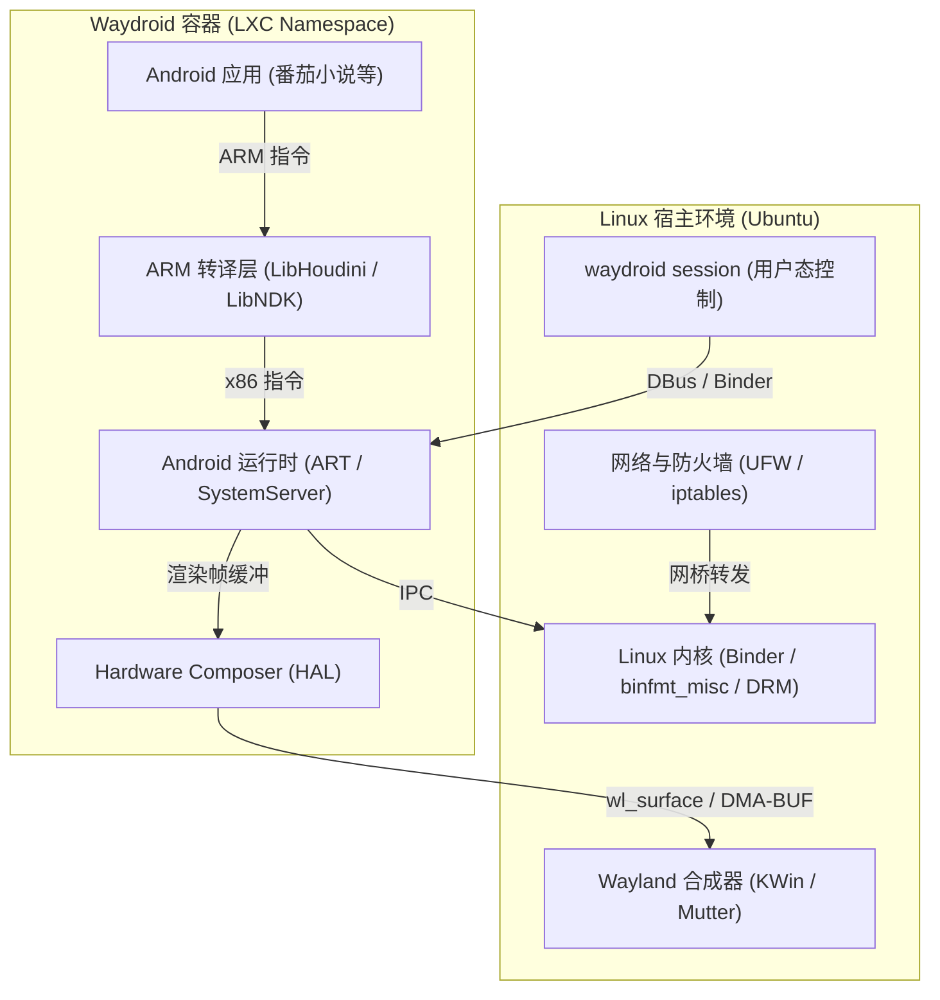

# 深入解析 Waydroid：核心运行原理、文件架构全景与彻底卸载指南

> **前言**：Waydroid 是现代 Linux 桌面运行 Android 应用的最强方案之一。为了帮助开发者和高级用户不仅“会用”，更能“知其所以然”，本文深度剖析 Waydroid 的**底层运行原理**（IPC、图形管线、ARM转译、网络路由），盘点其在 Linux 系统中的**完整文件与目录全景**，并提供一套**毫无残留的彻底卸载与清理方案**作为技术备忘。

---

## 目录
- [1. Waydroid 核心运行架构与原理](#1-waydroid-核心运行架构与原理)
  - [1.1 架构本质：LXC 容器 vs 传统虚拟机](#11-架构本质lxc-容器-vs-传统虚拟机)
  - [1.2 Binder IPC：系统调用的灵魂桥梁](#12-binder-ipc系统调用的灵魂桥梁)
  - [1.3 图形渲染流水线：从 HWComposer 到 Wayland](#13-图形渲染流水线从-hwcomposer-到-wayland)
  - [1.4 ARM 转译黑科技：LibHoudini / LibNDK 与 binfmt_misc](#14-arm-转译黑科技libhoudini--libndk-与-binfmt_misc)
  - [1.5 网络拓扑：虚拟网桥与路由转发](#15-网络拓扑虚拟网桥与路由转发)
- [2. Waydroid 系统文件与目录架构全景](#2-waydroid-系统文件与目录架构全景)
  - [2.1 系统镜像与配置目录（/var/lib/waydroid）](#21-系统镜像与配置目录varlibwaydroid)
  - [2.2 用户数据与应用存储（~/.local/share/waydroid）](#22-用户数据与应用存储localsharewaydroid)
  - [2.3 桌面图标与系统集成（~/.local/share/applications）](#23-桌面图标与系统集成localshareapplications)
  - [2.4 服务守护单元与临时运行时文件](#24-服务守护单元与临时运行时文件)
- [3. Waydroid 彻底卸载与无痕清理指南](#3-waydroid-彻底卸载与无痕清理指南)
  - [步骤 1：安全终止所有运行中会话与服务](#步骤-1安全终止所有运行中会话与服务)
  - [步骤 2：卸载核心软件包与清除 APT 源](#步骤-2卸载核心软件包与清除-apt-源)
  - [步骤 3：清除系统镜像、Overlay 与配置数据](#步骤-3清除系统镜像overlay-与配置数据)
  - [步骤 4：清除用户数据与 Android 内部存储](#步骤-4清除用户数据与-android-内部存储)
  - [步骤 5：彻底清理桌面应用菜单与图标缓存](#步骤-5彻底清理桌面应用菜单与图标缓存)
  - [步骤 6：清理网络规则与 UFW 防火墙残留](#步骤-6清理网络规则与-ufw-防火墙残留)
  - [步骤 7：一键彻底卸载 Shell 脚本备用](#步骤-7一键彻底卸载-shell-脚本备用)
- [4. 架构速查脑图与总结](#4-架构速查脑图与总结)

---

## 1. Waydroid 核心运行架构与原理



### 1.1 架构本质：LXC 容器 vs 传统虚拟机
- **传统虚拟机（QEMU、Genymotion、BlueStacks）**：需要在宿主机之上运行完整的 Hypervisor，虚拟出一整套虚拟主板、虚拟 CPU、虚拟显卡，并在其上加载独立的内核。这导致内存双重消耗、CPU 指令模拟损耗巨大、图形需要通过虚拟驱动中转。
- **Waydroid（LXC 容器方案）**：它**不是虚拟机**，而是一个基于 **LXC（Linux Containers）** 的系统级容器。Android 系统的所有进程（如 `zygote`、`surfaceflinger`、`system_server` 以及安装的 App）都是宿主机内核中的普通原生进程，仅仅通过 Linux 命名空间（Namespaces：PID、Mount、Network、IPC、UTS、User）与 cgroups 进行了隔离。因此，**CPU 与内存调度具有近乎零损耗的原生性能**。

### 1.2 Binder IPC：系统调用的灵魂桥梁
Android 系统的核心服务架构严重依赖 **Binder 进程间通信（IPC）机制**。
- 标准的 Linux 内核在早期并不默认开启 Binder。现代 Linux 内核（通过 `CONFIG_ANDROID_BINDER_IPC`、`CONFIG_ANDROID_BINDERFS`）内置了 `binderfs`。
- Waydroid 在启动容器时，会将宿主机的 `/dev/binderfs` 挂载到容器内的 `/dev/binder`、`/dev/vndbinder`、`/dev/hwbinder`。
- 这样，容器内的 Android 各系统服务与 HAL 层通过标准 Binder 驱动进行高速 IPC 交互，宿主机的 `waydroid session` 也可以通过跨容器的 binder 通信控制 Android 应用的生命周期。

### 1.3 图形渲染流水线：从 HWComposer 到 Wayland
Waydroid 的图形显示之所以极其流畅，归功于其特殊的显示合成器对接：
1. **HWComposer HAL**：Waydroid 内部定制了专门的硬件合成器服务 `android.hardware.graphics.composer`。
2. **Wayland Client 角色**：该服务在宿主用户会话中作为一个合法的 Wayland Client 运行，直接连接宿主合成器（如 KDE 的 KWin 或 GNOME 的 Mutter）的 Wayland Socket（`wayland-0`）。
3. **渲染模式**：
   - **硬件加速（GBM / DMA-BUF）**：直接向宿主申请 DRM 渲染节点（`/dev/dri/renderD129`），使用 Mesa 驱动在 GPU 显存内生成纹理缓冲区，通过 DMA-BUF 零拷贝直接递交给宿主合成器合成，性能最高。
   - **跨 GPU / 软件渲染（SwiftShader）**：当遇到双显卡或 NVIDIA 闭源驱动跨显卡传递限制时，可切换为 Google SwiftShader。它利用宿主机强大的多核 CPU 进行高性能并行栅格化，并将 CPU 共享内存像素缓冲直接提交给 Wayland 合成器，彻底消除黑屏。
4. **多窗口管理**：Waydroid 的 `vendor.waydroid.windowmanager` 会将 Android 内部的每个 Activity 映射为一个原生的 XDG-Toplevel 窗口，实现与 Linux 原生桌面窗口一致的移动、缩放、最大化体验。

### 1.4 ARM 转译黑科技：LibHoudini / LibNDK 与 binfmt_misc
x86_64 电脑无法直接执行 ARM（`armeabi-v7a`、`arm64-v8a`）的二进制指令。Waydroid 能够运行纯 ARM 应用，关键在于以下链条：
1. **Linux 内核 `binfmt_misc`**：通过内核特性注册识别 ARM 二进制文件头部魔数（Magic Number），当执行 ARM ELF 文件时，自动调用转译器。
2. **Native Bridge（本地桥接机制）**：Android ART 虚拟机在加载 JNI 动态库（`.so`）时，通过 `ro.dalvik.vm.native.bridge` 指定动态库（如 `libhoudini.so` 或 `libndk_translation.so`）。
3. **转译层差异**：
   - **LibNDK**：ChromeOS 提取版，执行 64 位（ARM64）性能出色，但在处理 32 位 Thumb 模式信号处理（`sa_restorer`）时容易报错。
   - **LibHoudini**：Intel 原厂方案，对 32 位与 64 位 ARM 指令（Thumb-2、NEON 指令集）做了深度 JIT（即时翻译）优化，兼容性最全面。

### 1.5 网络拓扑：虚拟网桥与路由转发
- **网桥创建**：宿主机启动时，Waydroid 创建虚拟网桥 `waydroid0`，分配网关 IP `192.168.240.1/24`。
- **DHCP / DNS 守护**：宿主机运行一个精简的 `dnsmasq` 实例，监听 `waydroid0`，提供 `192.168.240.2~254` 的 DHCP 租约。
- **容器网卡**：容器内部创建 `veth` 对，映射为 `eth0`，开机通过 DHCP 自动获取 IP。
- **防火墙 NAT**：内核启用 `net.ipv4.ip_forward=1`，并通过 iptables / ufw 将容器内部出站流量通过宿主物理网卡进行 SNAT/MASQUERADE 伪装，实现互联网互通。

---

## 2. Waydroid 系统文件与目录架构全景

掌握 Waydroid 的文件布局，是排查故障和彻底清理的关键：

### 2.1 系统镜像与配置目录（`/var/lib/waydroid`）
该目录是 Waydroid 的**核心引擎与系统根目录**，需要 root 权限访问：

| 路径 | 作用与内容 |
| :--- | :--- |
| `/var/lib/waydroid/images/system.img` | Android 系统基础镜像（只读挂载） |
| `/var/lib/waydroid/images/vendor.img` | 针对硬件 HAL 和 Waydroid 定制的 Vendor 镜像 |
| `/var/lib/waydroid/rootfs/` | 容器的联合根文件系统挂载点 |
| `/var/lib/waydroid/overlay/` | OverlayFS 下层目录，保存转译补丁等扩展组件 |
| `/var/lib/waydroid/overlay_rw/` | OverlayFS 可写层，记录对系统分区所做的改动 |
| `/var/lib/waydroid/overlay_work/` | OverlayFS 工作临时目录 |
| `/var/lib/waydroid/lxc/` | LXC 容器配置文件（包括安全上下文、设备映射规则） |
| `/var/lib/waydroid/waydroid.cfg` | Waydroid 全局主配置文件（镜像版本、ABI 列表、架构等） |
| `/var/lib/waydroid/waydroid_base.prop` | Android 系统基础属性配置文件（EGL渲染器、gralloc等） |
| `/var/lib/waydroid/waydroid.prop` | 容器启动时自动合并的 Android 运行时属性 |
| `/var/lib/waydroid/waydroid.log` | 容器启动、LXC 挂载以及系统服务的主调试日志 |

### 2.2 用户数据与应用存储（`~/.local/share/waydroid`）
该目录位于当前登录用户的 Home 目录下，存储所有**用户层面的数据**：

| 路径 | 作用与内容 |
| :--- | :--- |
| `~/.local/share/waydroid/data/` | **Android 完整 `/data` 分区**！包含所有已安装的 App、数据库、用户账号信息 |
| `~/.local/share/waydroid/data/media/0/` | Android 内部存储（即 Android 手机看到的 `/sdcard/`、下载目录、照片目录） |
| `~/.local/share/waydroid/data/icons/` | 从 Android APK 中提取出的桌面高清图标（`.png`） |
| `~/.local/share/waydroid/waydroid.log` | 用户级别会话的执行日志 |

### 2.3 桌面图标与系统集成（`~/.local/share/applications`）
当在 Waydroid 中安装应用时，系统会自动在宿主机生成桌面快捷方式：
- `~/.local/share/applications/waydroid.<package_name>.desktop`
  - 例如：`waydroid.com.dragon.read.desktop`（番茄小说）
  - 例如：`waydroid.com.android.settings.desktop`（Android 原生设置）
- 这些文件直接与 KDE / GNOME 桌面菜单集成，支持从 Linux 菜单直接点击唤起对应 App。

### 2.4 服务守护单元与临时运行时文件
- **系统服务**：`/lib/systemd/system/waydroid-container.service`
  - 负责拉起 `waydroid container start` 守护进程。
- **用户会话服务（若配置）**：`~/.config/systemd/user/waydroid-session.service`
  - 负责在用户登录桌面后维持 `waydroid session start`。
- **运行时锁与 PID**：
  - `/run/waydroid-lxc/`：包含 LXC 锁文件及 `dnsmasq.pid`。
  - `/var/lib/misc/dnsmasq.waydroid0.leases`：记录容器当前分配的 DHCP IP 租约。
- **内核接口**：
  - `/dev/binderfs/` 或 `/dev/binder`：Binder IPC 通信节点。
  - `/sys/fs/cgroup/`：Waydroid 专属的 cgroup 资源限制树。

---

## 3. Waydroid 彻底卸载与无痕清理指南

如果您需要彻底移除 Waydroid、释放几 GB 的磁盘空间，或者想要重新干净地初始化系统，请按照以下步骤进行完整清理：

### 步骤 1：安全终止所有运行中会话与服务
在卸载软件包之前，必须先停止所有容器和挂载：
```bash
# 1. 停止用户会话
waydroid session stop 2>/dev/null || true

# 2. 如果配置了 systemd 用户服务，禁用并停止
systemctl --user stop waydroid-session 2>/dev/null || true
systemctl --user disable waydroid-session 2>/dev/null || true
rm -f ~/.config/systemd/user/waydroid-session.service
systemctl --user daemon-reload

# 3. 停止系统容器服务
sudo systemctl stop waydroid-container
sudo systemctl disable waydroid-container
```

### 步骤 2：卸载核心软件包与清除 APT 源
```bash
# 卸载 waydroid 及关联组件
sudo apt purge -y waydroid lxc-utils

# 清理不再需要的自动安装依赖包
sudo apt autoremove --purge -y

# 删除 Waydroid 官方软件源与 GPG 密钥
sudo rm -f /etc/apt/sources.list.d/waydroid.list
sudo rm -f /usr/share/keyrings/waydroid.gpg
sudo apt update
```

### 步骤 3：清除系统镜像、Overlay 与配置数据
> [!CAUTION]
> 此步骤将删除下载的 Android 系统镜像（约 2GB~3GB）及所有底层修改。

```bash
# 卸载可能残留的 overlay 挂载点
sudo umount /var/lib/waydroid/rootfs/vendor 2>/dev/null || true
sudo umount /var/lib/waydroid/rootfs 2>/dev/null || true

# 彻底删除整个 /var/lib/waydroid 目录
sudo rm -rf /var/lib/waydroid
```

### 步骤 4：清除用户数据与 Android 内部存储
> [!WARNING]
> 此步骤将删除所有在 Waydroid 中安装的应用数据、阅读记录、缓存和 `/sdcard/` 文件！

```bash
# 删除用户级数据目录
rm -rf ~/.local/share/waydroid

# 清理 waydroid-script 缓存的转译包（Houdini / LibNDK 压缩包）
rm -rf ~/.cache/waydroid-script
rm -rf /tmp/waydroid_script
```

### 步骤 5：彻底清理桌面应用菜单与图标缓存
Waydroid 安装的应用在卸载后可能会在系统开始菜单中残留图标：
```bash
# 删除所有由 Waydroid 生成的 .desktop 快捷方式
rm -f ~/.local/share/applications/waydroid.*.desktop

# 刷新桌面数据库与图标缓存
update-desktop-database ~/.local/share/applications/ 2>/dev/null || true
```

### 步骤 6：清理网络规则与 UFW 防火墙残留
如果在安装时曾为 `waydroid0` 添加过 UFW 防火墙放行规则，可予以清理：
```bash
# 删除 UFW 中的 waydroid0 规则
sudo ufw delete allow in on waydroid0 2>/dev/null || true
sudo ufw route delete allow in on waydroid0 2>/dev/null || true
sudo ufw reload

# 清理运行时网络临时文件
sudo rm -rf /run/waydroid-lxc
sudo rm -f /var/lib/misc/dnsmasq.waydroid0.leases

# 清理网桥接口（如果仍存在，系统重启后也会自动消失）
sudo ip link delete waydroid0 2>/dev/null || true
```

---

### 步骤 7：一键彻底卸载 Shell 脚本备用

为了方便日后一键执行，您可以保存以下脚本为 `uninstall_waydroid.sh`，赋予执行权限后直接运行：

```bash
#!/usr/bin/env bash
# ==============================================================================
# Waydroid 彻底清理与完全卸载脚本
# ==============================================================================
set -e

echo "[1/6] 停止所有 Waydroid 进程与系统服务..."
waydroid session stop 2>/dev/null || true
systemctl --user stop waydroid-session 2>/dev/null || true
systemctl --user disable waydroid-session 2>/dev/null || true
rm -f ~/.config/systemd/user/waydroid-session.service
systemctl --user daemon-reload 2>/dev/null || true

sudo systemctl stop waydroid-container 2>/dev/null || true
sudo systemctl disable waydroid-container 2>/dev/null || true

echo "[2/6] 卸载软件包与清理 APT 软件源..."
sudo apt purge -y waydroid 2>/dev/null || true
sudo apt autoremove --purge -y
sudo rm -f /etc/apt/sources.list.d/waydroid.list
sudo rm -f /usr/share/keyrings/waydroid.gpg
sudo apt update -qq

echo "[3/6] 清理系统镜像与全局运行时目录 (/var/lib/waydroid)..."
sudo umount /var/lib/waydroid/rootfs/vendor 2>/dev/null || true
sudo umount /var/lib/waydroid/rootfs 2>/dev/null || true
sudo rm -rf /var/lib/waydroid
sudo rm -rf /run/waydroid-lxc
sudo rm -f /var/lib/misc/dnsmasq.waydroid0.leases

echo "[4/6] 清理当前用户的数据分区与缓存 (~/.local/share/waydroid)..."
rm -rf ~/.local/share/waydroid
rm -rf ~/.cache/waydroid-script
rm -rf /tmp/waydroid_script

echo "[5/6] 清除桌面快捷方式与图标..."
rm -f ~/.local/share/applications/waydroid.*.desktop
update-desktop-database ~/.local/share/applications/ 2>/dev/null || true

echo "[6/6] 还原网络与防火墙配置..."
sudo ufw delete allow in on waydroid0 2>/dev/null || true
sudo ufw route delete allow in on waydroid0 2>/dev/null || true
sudo ufw reload 2>/dev/null || true
sudo ip link delete waydroid0 2>/dev/null || true

echo "=============================================================================="
echo "🎉 Waydroid 已经从您的系统中彻底、干净地卸载完成！"
echo "=============================================================================="
```

---

## 4. 架构速查脑图与总结

| 层面 | 核心机制 | 常见排障切入点 |
| :--- | :--- | :--- |
| **容器层** | LXC Namespace + cgroups | 查看 `/var/lib/waydroid/waydroid.log` 检查 rootfs 挂载 |
| **IPC 机制** | Android BinderFS (`/dev/binder`) | 检查内核是否加载 `binder_linux` 或开启 `CONFIG_ANDROID_BINDERFS` |
| **图形管线** | HWComposer HAL ↔ Wayland (`wl_surface`) | 双显卡黑屏时将 EGL 改为 `swiftshader`，Gralloc 改为 `default` |
| **ARM 转译** | Native Bridge + `binfmt_misc` | 32位应用闪退优先选 `libhoudini`，64位应用推荐 `libndk` |
| **网络通信** | 网桥 `waydroid0` + DHCP + NAT | 检查 UFW 是否允许 `waydroid0` 路由与进出流量 |

通过理解这一整套协作机制，当我们在 Linux 平台上遇到 Android 应用图形撕裂、网络阻塞或指令集不兼容问题时，就能迅速定位到底是 **Wayland 共享内存**、**内核 Binder 驱动** 还是 **转译层 JIT 机制** 出现了问题，从而得心应手地调优与维护！
